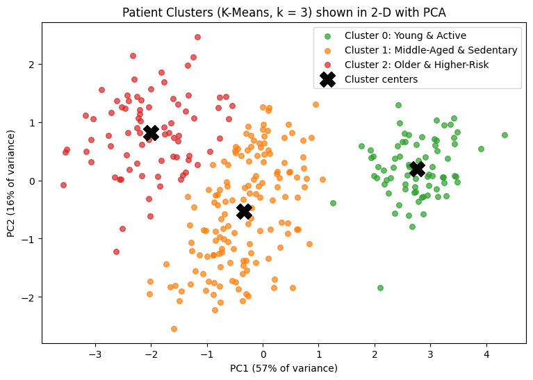
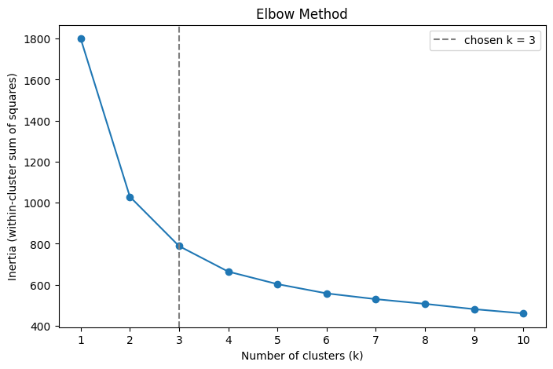
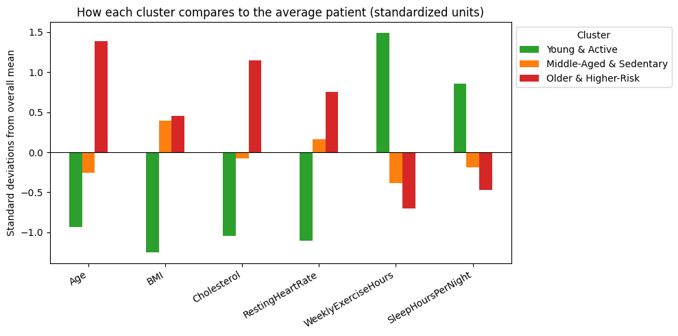

# Patient Health Clustering with K-Means

Unsupervised segmentation of 300 patients into three health profiles using K-Means, built as the final project for **COSC 3327: Introduction to Data Science** at Huston-Tillotson University.

<a href="https://colab.research.google.com/github/avisink/COSC_3327_Patient_Clustering/blob/main/Data_Science_Clustering_Final_Project.ipynb"></a>



## Overview

The dataset has no label column, so this is not a prediction task. K-Means groups patients who look similar across six health measurements, and each group's averages are then read back in real units (years, mg/dL, hours) to describe what kind of patient it represents. Segments like these could help a clinic decide who to offer preventive care to first.

## Data

[`Patient_Health_Clustering.csv`](Patient_Health_Clustering.csv): 300 patients, 7 columns, no missing values and no duplicates. It is small (about 10 KB), and the notebook reads it straight from this repo, so nothing needs to be downloaded.

| Column | Meaning |
|--------|---------|
| `PatientID` | Label only; dropped before clustering |
| `Age` | Age in years |
| `BMI` | Body Mass Index |
| `Cholesterol` | Total cholesterol (mg/dL) |
| `RestingHeartRate` | Beats per minute at rest |
| `WeeklyExerciseHours` | Hours of exercise per week |
| `SleepHoursPerNight` | Average hours of sleep per night |

Source: TODO(ayo): name where the dataset came from (for example, provided by the course instructor) and whether it is synthetic.

## Method

1. **Clean:** check for missing values, duplicate rows and duplicate IDs (none found), and drop `PatientID`, which is a label rather than a measurement.
2. **Scale:** standardize all six features with `StandardScaler`, so that large-valued features like cholesterol don't dominate the distance calculation.
3. **Choose k:** run K-Means for k = 1–10 and plot inertia (the elbow method). The curve bends at **k = 3**.
4. **Train:** fit K-Means with k = 3 (`n_init=10`, `random_state=42` for reproducible results), then renumber the clusters by average age so the labels stay stable across runs.
5. **Visualize and interpret:** project the data onto two PCA components for plotting (they keep 72% of the variance) and compare cluster averages in the original units.



## Results

| Cluster | Patients | Age | BMI | Cholesterol | Resting HR | Exercise (h/week) | Sleep (h/night) |
|---------|---------:|----:|----:|------------:|-----------:|------------------:|----------------:|
| 0: Young & Active | 75 | 27.8 | 22.4 | 169.7 | 62.2 | 7.3 | 7.4 |
| 1: Middle-Aged & Sedentary | 147 | 38.6 | 30.9 | 197.9 | 75.5 | 2.2 | 6.3 |
| 2: Older & Higher-Risk | 78 | 65.1 | 31.2 | 233.5 | 81.6 | 1.3 | 6.1 |



**Key findings**

- **The features move together.** Patients who exercise more also tend to have lower BMI, heart rate and cholesterol, and sleep more. That produces one clearly healthy group and one clearly at-risk group.
- **Cluster 0 is well separated** from the rest on the PCA plot. Clusters 1 and 2 touch at their edge.
- **Cluster 1 is the one to watch.** These patients average about 39 years old, but their BMI and activity levels already resemble the oldest, highest-risk group's. Lifestyle, more than age, separates them from Cluster 0, which makes them a natural target for preventive exercise and lifestyle programs.

**Limitations:** K-Means always returns exactly k groups, even when the boundaries are fuzzy. The choice of k = 3 is a judgment call (k = 4 would also be reasonable). The clusters describe patterns in this dataset; they are not medical diagnoses.

## How to run

**In Google Colab (no setup):** click the **Open in Colab** badge above, then choose **Runtime → Run all**.

**Locally:**

```bash
git clone https://github.com/avisink/COSC_3327_Patient_Clustering.git
cd COSC_3327_Patient_Clustering
python3 -m venv .venv
source .venv/bin/activate          # Windows: .venv\Scripts\Activate.ps1
pip install -r requirements.txt
jupyter notebook Data_Science_Clustering_Final_Project.ipynb
```

Then choose **Run All**. The notebook needs an internet connection because it reads the CSV from this repo's raw GitHub URL. To work offline, change the `url` in Section 2 to `"Patient_Health_Clustering.csv"`. With `random_state=42`, every run reproduces the cluster sizes above: 75, 147 and 78.

## Next steps

- Compare k = 3 and k = 4 with silhouette scores, not only the elbow method.
- Try a clustering method that allows fuzzy boundaries, such as a Gaussian mixture model, to handle the overlap between Clusters 1 and 2.
- Check cluster stability by re-fitting on bootstrap samples of the patients.

## Tech stack

Python · pandas · NumPy · scikit-learn (StandardScaler, KMeans, PCA) · Matplotlib · Jupyter / Google Colab

## Author

**Ayomide (Ayo) Isinkaye** · [GitHub](https://github.com/avisink) · [LinkedIn](https://www.linkedin.com/in/avisinkaye)
